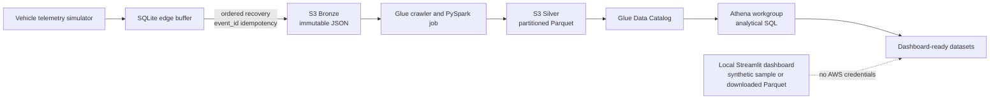
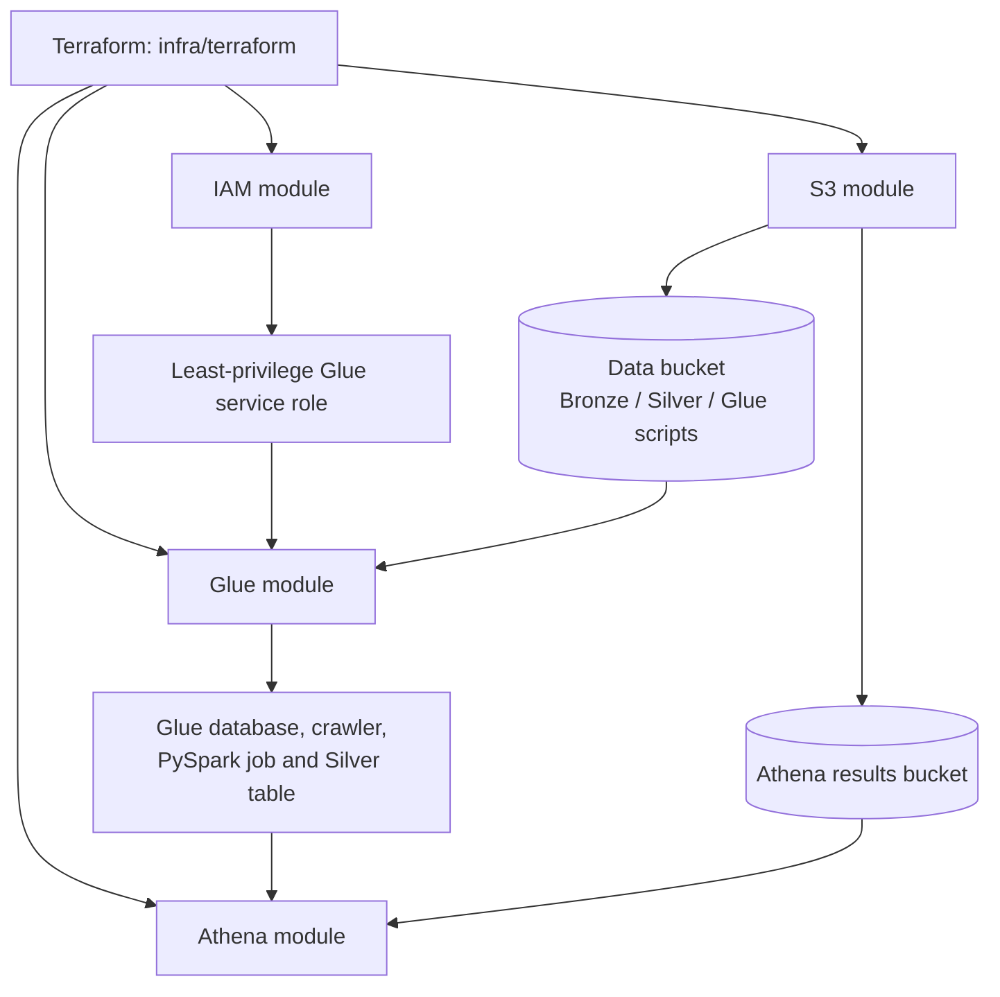

# DriveSense Connected Vehicle Platform

DriveSense is a cloud-native, offline-first telemetry analytics platform for a fictional connected-vehicle fleet. It is an engineering portfolio project that simulates the data and failure modes a large automotive manufacturer might need to analyse: intermittent connectivity, late events, duplicate messages, invalid sensor readings, and missing HMI warnings.

> All vehicles, journeys, positions, service events, and telemetry in this repository are synthetic or publicly available. DriveSense is independent and is not affiliated with, endorsed by, or built for any vehicle manufacturer.

## What the project demonstrates

- Offline-first event buffering and ordered recovery with `event_id` idempotency.
- A lakehouse-style path from immutable raw data to queryable Parquet data.
- Explicit data-quality controls and a quarantine path for invalid records.
- Terraform-defined infrastructure validated by CI before any manual deployment.
- A Streamlit presentation layer that uses a committed synthetic sample and does not access AWS.

## How the platform works



The simulator deliberately creates operational edge cases. The processing path preserves the original `event_id`, handles late and out-of-order arrivals, and makes quality outcomes visible instead of silently treating every record as valid.

## Infrastructure relationship

Terraform describes the AWS analytics layer. It does not apply anything automatically.



When a reviewed plan is applied, the modules declare the following resources in the selected AWS Region:

| Module | Declared infrastructure | Relationship to DriveSense |
| --- | --- | --- |
| S3 | Data bucket, Athena-results bucket, encryption, versioning and public-access blocks | Stores immutable Bronze input, curated Silver output, Glue scripts and Athena results. |
| IAM | Glue service role and scoped policies | Lets Glue access only the required data locations. |
| Glue | Catalog database, crawler, PySpark job and Silver table | Transforms and catalogs the Bronze-to-Silver telemetry pipeline. |
| Athena | Workgroup and saved analytical queries | Runs governed SQL analysis over the cataloged Silver data. |

The dashboard is intentionally outside this deployment path: it is a presentation layer, not an always-on AWS application or vehicle-control service.

## Quick start

```powershell
python -m venv .venv
.venv\Scripts\Activate.ps1
pip install -e ".[dev]"
python scripts/generate_telemetry.py --vehicles 10 --trips 20 --events 1000 --output data/generated/telemetry.jsonl
pytest
docker build .
```

For the local visual presentation layer:

```powershell
pip install -e ".[ui]"
streamlit run app/dashboard.py
```

The dashboard reads the committed synthetic JSONL sample by default. It can also read local or downloaded Silver Parquet through `DRIVESENSE_DASHBOARD_DATA`; it does not receive AWS credentials or directly access project buckets.

## Stack and delivery

- Python 3.11, SQLite edge buffer, pytest, Ruff and mypy.
- Amazon S3, Glue Data Catalog/crawler/PySpark, and Athena.
- Terraform modules with encryption-at-rest defaults, public-access blocks, tags, and a least-privilege Glue role.
- GitHub Actions validates Python, Terraform, Docker, and formatting. CI never deploys AWS infrastructure.

## Review infrastructure safely

Terraform defaults to `us-east-2`, the selected project Region. Authenticate with the approved external AWS profile or SSO flow, then review the plan before making any change:

```powershell
terraform -chdir=infra/terraform/environments/dev init
terraform -chdir=infra/terraform/environments/dev plan -var="aws_region=us-east-2"
```

The Glue script is uploaded as a Terraform-managed S3 object, so a script change is visible in the reviewed plan before deployment. There is no automatic `terraform apply` in this repository.

## Scope and limitations

V1 is a deterministic simulation. It does not claim real-world coverage prediction, live maps, OEM data, streaming infrastructure, continuous dashboard hosting, or automated BI provisioning. The current Silver catalog table is scoped to the recorded controlled demo run; a multi-run production lake layout is a planned evolution rather than an implicit production claim.

## Further reading

- [Architecture](docs/architecture.md)
- [AWS architecture](docs/aws-architecture.md)
- [Offline-first design](docs/offline-first.md)
- [Data quality](docs/data-quality.md)
- [Cost model](docs/cost-model.md)
- [Route intelligence](docs/route-intelligence.md)
- [Streamlit dashboard](docs/dashboard.md)
- [Project backlog](docs/project-backlog.md)
